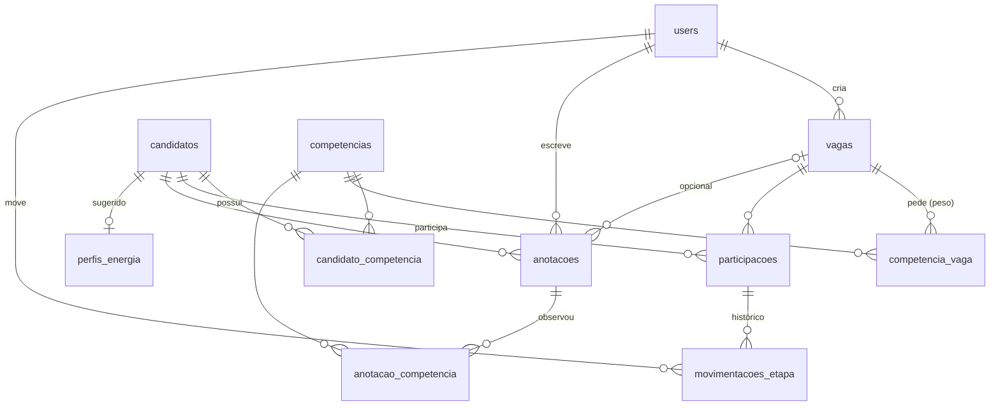

# Data Model: Banco de Talentos SETIC — MVP

**Feature**: `001-banco-de-talentos-mvp` | **Date**: 2026-10-30 | **Plan**: [plan.md](./plan.md)

Modelo relacional portável entre SQLite (local/testes) e MySQL 8.4 (Docker). Nomes de domínio
em português, como na spec. Tabelas com plural irregular declaram o nome explicitamente no
model (`participacoes`, `anotacoes`, `movimentacoes_etapa`, `registros_exclusao`,
`perfis_energia`).

## Diagrama



## Enums (`app/Enums`, persistidos como string)

| Enum | Casos (valor → rótulo) |
|---|---|
| `TipoCandidato` | `servidor` → Servidor · `estagiario` → Estagiário |
| `TipoCandidatoVaga` | `servidor` · `estagiario` · `ambos` → Servidores e estagiários |
| `Area` | `desenvolvimento` · `infraestrutura` → Infraestrutura e Redes · `suporte` → Suporte Técnico · `dados` → Dados e BI · `produto` → Produto e Análise de Sistemas · `seguranca` → Segurança da Informação · `design` → Design e UX |
| `CategoriaCompetencia` | `hard` → Técnica (hard skill) · `soft` → Comportamental (soft skill) |
| `OrigemCompetencia` | `curriculo` → Declarada no currículo · `revisao` → Adicionada na revisão · `entrevista` → Observada em entrevista |
| `StatusCandidato` | `ativo` · `desativado` |
| `StatusVaga` | `aberta` · `encerrada` |
| `EtapaSelecao` | `triagem` · `entrevista` · `aprovado` |
| `PesoCompetencia` (int) | `1` → Desejável · `2` → Importante · `3` → Essencial |
| `MeioConsentimento` | `email` · `formulario` · `declaracao_ciee` → Declaração do CIEE · `presencial` · `outro` |
| `OrigemPerfilEnergia` | `ia` → Sugerido pela IA · `humano` → Revisado por humano |
| `MotivoExclusao` | `pedido_titular` → Pedido do titular · `retencao` → Fim do prazo de retenção · `outro` |

## Tabelas

### `users` (existente)

Recrutadores. Sem alterações de esquema. Perfil único (FR-028).

### `competencias` — catálogo padronizado (FR-014)

| Coluna | Tipo | Regras |
|---|---|---|
| `id` | bigint PK | |
| `nome` | string(80) | obrigatório, único (ex.: "Python", "Inglês intermediário") |
| `slug` | string(90) | único, gerado do nome |
| `categoria` | string | `CategoriaCompetencia`, índice |
| `area` | string null | `Area`; área principal, usada na sugestão de área (R5) |
| `sinonimos` | json | lista de strings, padrão `[]` (ex.: `["postgres","postgresql"]`) |
| `grupo` | string(40) null | só idiomas (ex.: `ingles`) |
| `nivel` | tinyint null | só idiomas: 1 básico, 2 intermediário, 3 avançado |
| timestamps | | |

Regras: `grupo` e `nivel` são preenchidos juntos ou ficam ambos nulos. Itens novos só entram
pela tela de revisão ("adicionar ao catálogo") ou pelo seeder.

### `candidatos` (FR-001, FR-002)

| Coluna | Tipo | Regras |
|---|---|---|
| `id` | bigint PK | |
| `codigo` | string(9) | único, `CAND-NNNN` aleatório, imutável (R10) |
| `tipo` | string | `TipoCandidato`, índice |
| `area` | string | `Area`, índice |
| `status` | string | `StatusCandidato`, padrão `ativo`, índice |
| `nome` | string(150) | obrigatório — **identidade** |
| `email` | string(150) null | índice (duplicidade) — **contato** |
| `telefone` | string(30) null | **contato** |
| `cpf` | char(11) null | só dígitos, índice (duplicidade) — **identidade** |
| `data_nascimento` | date null | **identidade** (idade) |
| `formacoes` | json | lista de strings |
| `experiencias` | json | lista de strings |
| `experiencia_na_area` | boolean | `true` = sim · `false` = **não informado** (nunca "não possui") |
| `projetos` | json | lista de strings |
| `links` | json | lista de URLs — oculto na triagem |
| `texto_curriculo` | longText null | texto extraído; base para reanálise e IA (anonimizado antes do envio) |
| `curriculo_arquivo` | string null | caminho no disco `curriculos` (`{uuid}.pdf`) |
| `curriculo_nome_original` | string null | |
| `curriculo_tamanho` | unsigned int null | bytes |
| `consentimento_meio` | string | `MeioConsentimento`, obrigatório |
| `consentimento_em` | date | obrigatório, ≤ hoje |
| `consentimento_registrado_por` | FK users null | `nullOnDelete` |
| `dados_atualizados_em` | timestamp | base da retenção |
| timestamps | | |

- `$hidden`: `nome`, `email`, `telefone`, `cpf`, `data_nascimento`, `links`, `texto_curriculo`,
  `curriculo_arquivo`.
- Casts: enums, `array` nos campos json, `date`/`datetime`.
- Derivados (acessores, não persistidos): `idade`; `retencao_ate` = `dados_atualizados_em` +
  `config('banco_talentos.retencao_anos')` anos; `retencao_vencida`.
- Escopos: `ativos()`, `elegiveisPara(Vaga)` (ativo e, se a vaga não for `ambos`, `tipo` igual),
  `retencaoVencida()`.

### `candidato_competencia` (Competência do Candidato)

| Coluna | Tipo | Regras |
|---|---|---|
| `id` | bigint PK | |
| `candidato_id` | FK candidatos | `cascadeOnDelete` |
| `competencia_id` | FK competencias | `restrictOnDelete` |
| `origem` | string | `OrigemCompetencia` |
| timestamps | | |

Único (`candidato_id`, `competencia_id`); índice (`competencia_id`, `candidato_id`) para os
filtros. Precedência de origem ao reatribuir: `entrevista` > `revisao` > `curriculo` (observar
em entrevista "promove" a competência; reimportar o PDF não rebaixa uma competência observada).

### `vagas` (FR-015)

| Coluna | Tipo | Regras |
|---|---|---|
| `id` | bigint PK | |
| `titulo` | string(120) | obrigatório |
| `area` | string | `Area` |
| `tipo_candidato` | string | `TipoCandidatoVaga` |
| `descricao` | text null | até 1000 caracteres |
| `status` | string | `StatusVaga`, padrão `aberta`, índice |
| `energia_dinamico_analitico` | tinyint null | 1 = dinâmico … 5 = analítico |
| `energia_individual_equipe` | tinyint null | 1 = individual … 5 = equipe |
| `energia_execucao_planejamento` | tinyint null | 1 = execução … 5 = planejamento |
| `criada_por` | FK users null | `nullOnDelete` |
| `encerrada_em` | timestamp null | |
| timestamps | | |

Os três eixos de energia são preenchidos juntos ou ficam todos nulos.

### `competencia_vaga` (Competência da Vaga, FR-016)

| Coluna | Tipo | Regras |
|---|---|---|
| `id` | bigint PK | |
| `vaga_id` | FK vagas | `cascadeOnDelete` |
| `competencia_id` | FK competencias | `restrictOnDelete` |
| `peso` | tinyint | `PesoCompetencia` (1, 2 ou 3) |
| timestamps | | |

Único (`vaga_id`, `competencia_id`). Uma vaga precisa de ao menos uma competência (validação).

### `participacoes` (Participação na Seleção, FR-021, FR-022)

| Coluna | Tipo | Regras |
|---|---|---|
| `id` | bigint PK | |
| `vaga_id` | FK vagas | `cascadeOnDelete` |
| `candidato_id` | FK candidatos | `cascadeOnDelete` |
| `etapa` | string | `EtapaSelecao` |
| timestamps | | |

Único (`vaga_id`, `candidato_id`). Criada na primeira movimentação (R8); ausência de linha =
triagem.

### `movimentacoes_etapa` (histórico, FR-024)

| Coluna | Tipo | Regras |
|---|---|---|
| `id` | bigint PK | |
| `participacao_id` | FK participacoes | `cascadeOnDelete` |
| `user_id` | FK users null | `nullOnDelete` |
| `de` | string | `EtapaSelecao` |
| `para` | string | `EtapaSelecao` |
| `created_at` | timestamp | |

### `anotacoes` (Anotação de Entrevista, FR-026, FR-027)

| Coluna | Tipo | Regras |
|---|---|---|
| `id` | bigint PK | |
| `candidato_id` | FK candidatos | `cascadeOnDelete` |
| `vaga_id` | FK vagas null | `nullOnDelete` (anotação sem vaga é válida — US5-4) |
| `user_id` | FK users null | autor, automático, `nullOnDelete` |
| `texto` | text | obrigatório, até 5000 caracteres |
| timestamps | | `created_at` é a data exibida |

Listagem sempre por `created_at` decrescente.

### `anotacao_competencia` (competências observadas)

| Coluna | Tipo | Regras |
|---|---|---|
| `anotacao_id` | FK anotacoes | `cascadeOnDelete` |
| `competencia_id` | FK competencias | `restrictOnDelete` |

PK composta. Ao salvar, cada competência observada é gravada (ou promovida) em
`candidato_competencia` com origem `entrevista` (US5-3).

### `perfis_energia` (Perfil de Energia do candidato, FR-034)

| Coluna | Tipo | Regras |
|---|---|---|
| `id` | bigint PK | |
| `candidato_id` | FK candidatos | único, `cascadeOnDelete` |
| `dinamico_analitico` | tinyint | 1–5 |
| `individual_equipe` | tinyint | 1–5 |
| `execucao_planejamento` | tinyint | 1–5 |
| `justificativa` | text | até 500 caracteres |
| `origem` | string | `OrigemPerfilEnergia` |
| `revisado_por` | FK users null | preenchido quando `origem = humano` |
| `analisado_em` | timestamp | |
| timestamps | | |

O perfil **desejado** da vaga fica nas colunas `energia_*` de `vagas`. Ausência de linha =
"não analisado"; falha da IA = "análise indisponível" (mensagem, nada é gravado).

### `registros_exclusao` (Registro de Exclusão, FR-030)

| Coluna | Tipo | Regras |
|---|---|---|
| `id` | bigint PK | |
| `user_id` | FK users null | responsável, `nullOnDelete` |
| `motivo` | string | `MotivoExclusao` |
| `excluido_em` | timestamp | |

Sem dado pessoal, código ou id do candidato excluído.

## Transições de estado

### Etapa da participação (por vaga)

```text
            ┌──────────── mover ────────────┐
            ▼                               │
 (elegível) TRIAGEM ──mover──▶ ENTREVISTA ──mover──▶ APROVADO
   anônimo     ▲                 identidade     identidade
               └──── voltar ─────┘ revelada      revelada
                                 (só nesta vaga)
```

- Todas as transições entre as três etapas são permitidas (inclusive voltar), sempre por ação
  humana; cada uma grava `movimentacoes_etapa`.
- Bloqueios: vaga `encerrada` (somente leitura), candidato `desativado` e candidato não elegível
  para a vaga.
- Voltar para `triagem` torna o candidato anônimo de novo naquela vaga.

### Status do candidato

`ativo ⇄ desativado` (reversível) → **exclusão definitiva** (irreversível; gera
`registros_exclusao`).

### Status da vaga

`aberta → encerrada` (sem reabertura no MVP). Encerrada mantém quadro e histórico para
consulta.

## Valores derivados

| Valor | Regra | Onde |
|---|---|---|
| Aderência | `round(Σ pesos atendidos ÷ Σ pesos da vaga × 100)`; idiomas atendem por grupo e nível ≥ | `CalculadoraAderencia` (R7) |
| Desempate | percentual ↓, peso essencial atendido ↓, `created_at` ↑, `id` ↑ | `RankingVagaService` |
| Proximidade de energia | `round((1 − Σ|vaga − candidato| ÷ 12) × 100)` | `ProximidadeEnergia` (R13) |
| Retenção | `dados_atualizados_em + 2 anos`; vencida se `< agora` | acessor em `Candidato` |
| Idade | a partir de `data_nascimento` | acessor (só na gestão do banco ou após revelação) |

## Regras de validação (resumo)

| Operação | Regras principais |
|---|---|
| Upload de currículo | `arquivo`: obrigatório, `mimes:pdf`, `max:10240`; `tipo`: `TipoCandidato` |
| Confirmar importação / editar | `nome` obrigatório ≤ 150; `email` e-mail válido; `cpf` 11 dígitos após normalização; `data_nascimento` < hoje; `tipo` e `area` enums; listas como arrays de strings ≤ 300; `links.*` URL; `competencias.*` existentes; `consentimento_meio` enum obrigatório; `consentimento_em` data ≤ hoje obrigatória; `modo` `novo` ou `atualizar` (+ `candidato_existente_id` se atualizar) |
| Salvar vaga | `titulo` obrigatório ≤ 120; `area` e `tipo_candidato` enums; `competencias` array mín. 1; `competencias.*.id` distintos e existentes; `competencias.*.peso` ∈ {1, 2, 3}; `energia.*` inteiros 1–5, todos ou nenhum |
| Mover etapa | `etapa` ∈ `EtapaSelecao`; vaga aberta; candidato ativo e elegível |
| Anotação | `texto` obrigatório ≤ 5000; `vaga_id` existente (opcional na gestão do banco); `competencias_observadas.*` existentes |
| Exclusão | `motivo` enum; `confirmacao` aceita |
| Ajuste de energia | 3 eixos inteiros 1–5 obrigatórios; `justificativa` ≤ 500 |

## Mapa de exclusão (FR-030)

`DELETE candidatos` → `candidato_competencia`, `participacoes` → `movimentacoes_etapa`,
`anotacoes` → `anotacao_competencia`, `perfis_energia` (por *cascade*) + arquivo do PDF
(depois do commit) + uma linha em `registros_exclusao`. Vagas e catálogo não são afetados.

## Índices relevantes para desempenho

`candidatos(status, tipo)`, `candidatos(area)`, `candidatos(email)`, `candidatos(cpf)`,
`candidato_competencia(competencia_id, candidato_id)`, `participacoes(vaga_id, etapa)`,
`vagas(status)`. O volume previsto (dezenas a poucos milhares de candidatos) dispensa outras
otimizações.
